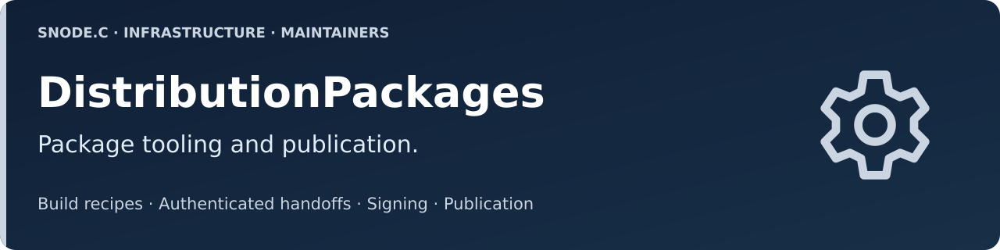

<a id="banner"></a>
<a id="project-overview"></a>

<p><picture><source media="(max-width: 600px)" srcset="docs/media/hero-mobile.svg"></picture></p>

<!-- snodec:begin organization -->
<p><a href="https://github.com/VolkerChristian#banner" title="Volker Christian account"><picture><source media="(max-width: 640px) and (prefers-color-scheme: dark)" srcset="docs/media/nav/account-icon-dark.svg"><source media="(max-width: 640px)" srcset="docs/media/nav/account-icon-light.svg"><source media="(prefers-color-scheme: dark)" srcset="docs/media/nav/account-dark.svg"></picture></a><a href="https://github.com/SNodeC#banner" title="SNode.C organization"><picture><source media="(max-width: 640px) and (prefers-color-scheme: dark)" srcset="docs/media/nav/organization-icon-dark.svg"><source media="(max-width: 640px)" srcset="docs/media/nav/organization-icon-light.svg"><source media="(prefers-color-scheme: dark)" srcset="docs/media/nav/organization-dark.svg"></picture></a><a href="#banner" title="DistributionPackages repository"><picture><source media="(max-width: 640px) and (prefers-color-scheme: dark)" srcset="docs/media/nav/repository-icon-dark.svg"><source media="(max-width: 640px)" srcset="docs/media/nav/repository-icon-light.svg"><source media="(prefers-color-scheme: dark)" srcset="docs/media/nav/repository-dark.svg"></picture></a><br clear="all"></p>
<!-- snodec:end organization -->

# DistributionPackages

Build recipes, authenticated handoffs, signing and publication for SNode.C distribution packages. This is the maintainer control repository; [Packages](https://github.com/SNodeC/Packages#banner) is the public installation and availability hub.

## Operations

This repository authenticates, signs and publishes successful product-package builds, then requests MQTTSuite and native IDP builds after SNode.C publication. Its manual publication workflow copies guides and renders recorded package status. See the organization [workflow graph](https://github.com/SNodeC/.github/blob/main/docs/workflow-graph.md#banner) for the complete chain and trigger contracts.

- [Documentation](docs/README.md#banner)
- [Publication and maintenance](docs/maintainers.md#banner)
- [CI setup](docs/setup.md#banner)
- [Authored Packages documentation](site/README.md#banner) (source template; navigation is resolved in the published Packages snapshot)
- [Target definitions](ci/targets/)

## Interfaces

Product workflows call the captured scripts in `ci/`. Signing accepts only deliberately allow-listed projects and verified run identities. Public documentation lives under `site/`; generated status is rendered from Packages records by `ci/publish/publication.py`. Catalogue changes do not grant signing rights.

## Local verification

```sh
python3 -m unittest discover -s tests -v
```

Tests use temporary repositories and fixtures; they do not dispatch CI or publish packages.
