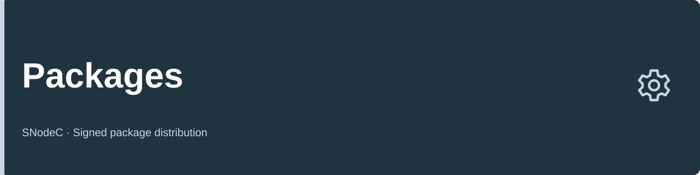

<!-- Published from DistributionPackages/site; edit that source, not this snapshot. -->

# SNodeC Packages

Signed packages for the SNode.C ecosystem. Choose a project and distribution, install using its signed package source, and inspect availability separately from ongoing builds.

## Projects

<!-- packages:begin projects -->
| Project | Latest release | Status |
| --- | --- | --- |
| [SNode.C](https://github.com/SNodeC/snode.c#project-overview) | 2.0.0 · r9 | [SNode.C status →](status/snodec.md#page-overview) |
| [MQTTSuite](https://github.com/SNodeC/mqttsuite#project-overview) | 1.0.2 · r9 | [MQTTSuite status →](status/mqttsuite.md#page-overview) |
<!-- packages:end projects -->

## Quick start

1. Choose a project above; its status page shows the latest captured release and the packages actually available for each target.
2. Open your distribution guide below and check its requirements, including CRB/EPEL on Rocky Linux.
3. Choose **complete sets** or **selected packages** before installing. The guide provides both routes and manual signed-repository setup; dependencies are installed automatically.

## Install

Select the guide matching your installed distribution, release and package architecture. Each guide covers requirements, quick installation, manual repository setup and updates. To install selected components rather than the complete sets, use the [project catalogs](#projects).

## Platforms

The supported release and architecture matrix is generated from the publisher's target definitions. Availability is reported per project and target.

<!-- packages:begin platforms -->
| Distribution | Releases | Architectures |
| --- | --- | --- |
| [OpenWrt](docs/openwrt.md#page-overview) | 24.10, 25.12 | 25 per release (names can differ) |
| [Raspberry Pi OS](docs/raspberrypi.md#page-overview) | bookworm, trixie | arm64 |
| [Debian](docs/debian.md#page-overview) | forky, sid, trixie | amd64, arm64, armhf, riscv64 |
| [Ubuntu](docs/ubuntu.md#page-overview) | noble, resolute | amd64, arm64 |
| [Rocky Linux](docs/rocky.md#page-overview) | 10, 9 | aarch64, x86_64 |
| [Fedora](docs/fedora.md#page-overview) | 43, 44 | aarch64, x86_64 |
<!-- packages:end platforms -->

## Signing keys

The key guide identifies each verification key, its supported distributions, fingerprints and installation method. Keys do not vary by architecture. Keep signature verification enabled.

## Troubleshooting

Read [installation troubleshooting](docs/troubleshooting.md#page-overview) for repository, key and dependency problems. For an ongoing build or an older version still available, open [project status](status/README.md#page-overview).

## How publication works

[Publication architecture](docs/architecture.md#page-overview) explains signing, revisions, status semantics and documentation ownership. Maintainer operations live in DistributionPackages.

## Contributing

Report installation issues in [Packages](https://github.com/SNodeC/Packages/issues). Documentation and publisher changes belong to [DistributionPackages](https://github.com/SNodeC/DistributionPackages#project-overview). Do not edit generated feeds, keys or status pages by hand.

## Ecosystem

[SNodeC organization](https://github.com/SNodeC) · [SNode.C](https://github.com/SNodeC/snode.c#project-overview) · [MQTTSuite](https://github.com/SNodeC/mqttsuite#project-overview)

[Contributing](https://github.com/SNodeC/.github/blob/HEAD/CONTRIBUTING.md) · [Security](https://github.com/SNodeC/.github/blob/HEAD/SECURITY.md)
